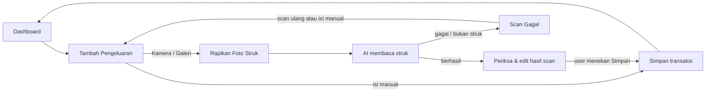
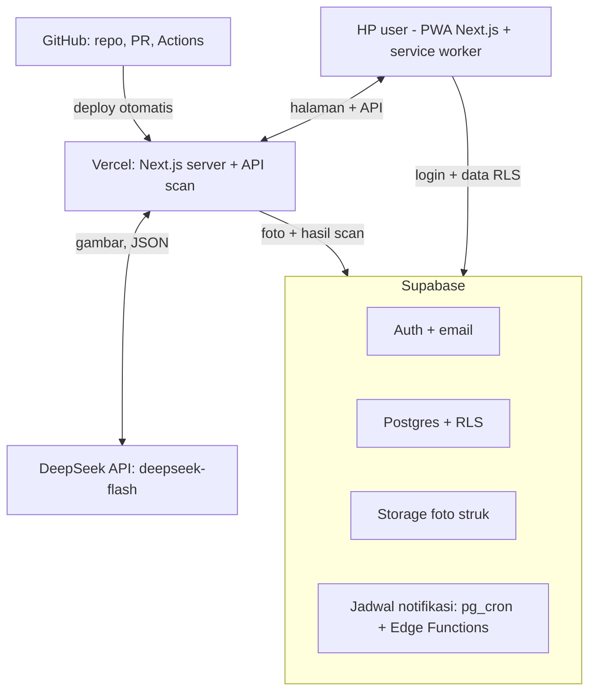

# PRD – Kasku (Expense Tracker PWA)

Diperbarui 7 Nov 2026. Sumber utama: dokumen PRD di Claude Docs. Mockup: canvas Claude Design (dikirim lewat "Hand off to Claude Code").

## 1. Ringkasan produk

Kasku adalah aplikasi pencatat pengeluaran berbentuk PWA (mobile-only) yang bisa mengisi form otomatis dari foto struk memakai AI. Mata uang tunggal Rupiah (IDR), bahasa Indonesia dan English. Nama "Kasku" masih sementara.

**Masalah.** Mencatat pengeluaran secara manual itu merepotkan, sehingga kebanyakan orang berhenti setelah beberapa hari. Struk kertas mudah hilang, dan tanpa catatan rutin orang tidak tahu ke mana uangnya pergi.

**Solusi.** Foto struk → AI membaca total, toko, tanggal, kategori, dan rincian item → user memeriksa dan mengedit → simpan. Data lalu diringkas di dashboard (harian, mingguan, bulanan, tahunan) dan dibandingkan dengan anggaran.

**Target pengguna.**

- Utama: penonton konten sosial media pembuat aplikasi, mayoritas berlokasi di Papua. Proses development direkam dan dijadikan konten.
- Profil: pengguna HP (Android dan iPhone) yang ingin mencatat pengeluaran pribadi atau rumah tangga dengan cepat.
- Konteks Papua: koneksi internet bisa lambat atau putus-sambung, jadi aplikasi harus ringan dan tetap bisa dibuka saat sinyal lemah.

**Metrik sukses (usulan, 3 bulan setelah rilis).**

| Metrik | Target | Cara ukur |
| --- | --- | --- |
| Akun terdaftar dan terverifikasi | [TARGET] | tabel `auth.users` |
| User aktif mingguan (≥ 1 transaksi/minggu) | ≥ 40% dari akun terdaftar | query `expenses` |
| Transaksi yang diinput lewat scan | ≥ 50% | kolom `source` |
| Scan yang disimpan tanpa koreksi total | ≥ 80% | bandingkan hasil AI vs data tersimpan |
| Waktu dari buka kamera sampai simpan | median ≤ 30 detik | event analytics |
| Pengguna yang memasang PWA ke layar utama | ≥ 30% | event `appinstalled` |

## 2. Ruang lingkup

MVP mencakup semua layar di mockup Claude Design, kecuali push notification ke HP dan export PDF yang masuk fase 2.

**Masuk MVP**

- Register, login, verifikasi email, lupa dan ubah kata sandi (email + password).
- Input pengeluaran manual.
- Scan struk lewat kamera atau galeri, AI prefill, review dan bulk edit sebelum simpan.
- Dashboard harian, mingguan, bulanan, tahunan + kategori teratas + transaksi terbaru.
- Riwayat transaksi dengan pencarian, filter kategori, edit, dan hapus.
- Export CSV.
- Anggaran bulanan total dan per kategori.
- Kelola kategori (tambah, ubah nama dan warna, hapus).
- Notifikasi di dalam aplikasi (daftar di ikon lonceng) + pengaturan notifikasi.
- Halaman Akun, Syarat & Ketentuan, Kebijakan Privasi.
- Bahasa Indonesia dan English, mata uang IDR saja.
- PWA: bisa dipasang ke layar utama, tampilan selalu mobile (lebar maks 430 px, di tengah pada desktop).

**Fase 2**

- Push notification ke HP (Web Push).
- Export PDF, termasuk opsi lampiran foto struk.
- Insight pola belanja (lonjakan kategori, transaksi terbesar).
- Mode offline penuh: input saat tidak ada sinyal, sinkron saat online.

**Di luar lingkup**

- Pemasukan, saldo rekening, dan transfer antar akun.
- Mata uang selain IDR.
- Login dengan Google/Apple/nomor HP.
- Akun bersama atau keluarga.
- Aplikasi native di Play Store/App Store.
- Tampilan desktop khusus.

## 3. Kebutuhan fungsional

Setiap kebutuhan punya ID agar bisa dirujuk di issue GitHub dan commit.

### 3.1 Autentikasi

- **AUTH-01** Register dengan nama, email, kata sandi, ulangi kata sandi, dan centang persetujuan Syarat & Ketentuan + Kebijakan Privasi.
- **AUTH-02** Kata sandi minimal 8 karakter, ada huruf besar dan kecil, ada angka. Strength bar dan checklist tampil saat mengetik.
- **AUTH-03** Setelah register, Supabase mengirim email verifikasi. Akun belum terverifikasi tidak bisa login.
- **AUTH-04** Login email + kata sandi. Pesan error tidak membedakan "email tidak ada" dan "kata sandi salah".
- **AUTH-05** Lupa kata sandi: user hanya memasukkan email. Layar konfirmasi selalu tampil dengan pesan netral ("Jika email terdaftar…"), berisi 3 langkah cek inbox, info link berlaku 1 jam, dan tombol kirim ulang dengan jeda 60 detik. Tidak ada tombol buka aplikasi email.
- **AUTH-06** Lupa kata sandi bisa dibuka dari layar Login dan layar Ubah Kata Sandi.
- **AUTH-07** Link reset di email membuka halaman "Buat kata sandi baru" di aplikasi.
- **AUTH-08** Ubah kata sandi dari Akun: kata sandi lama, kata sandi baru dengan aturan AUTH-02, konfirmasi. Tombol simpan aktif hanya jika semua valid. Sesi di perangkat lain dicabut.
- **AUTH-09** Logout dari halaman Akun.

### 3.2 Input pengeluaran manual

- **EXP-01** Field: jumlah (Rp, bilangan bulat), nama toko/keterangan, tanggal (default hari ini), kategori (chip), metode bayar (Tunai, Debit, QRIS, Kartu kredit, E-wallet), catatan opsional.
- **EXP-02** Jumlah dan tanggal wajib. Jumlah > 0.
- **EXP-03** Tombol Simpan sticky di bawah layar, form di atasnya bisa di-scroll.
- **EXP-04** Di atas form ada kartu "Isi otomatis dari struk" dengan tombol Kamera dan Galeri.
- **EXP-05** Transaksi bisa diedit dan dihapus dari Riwayat.

### 3.3 Scan struk dengan AI

- **SCAN-01** Kamera memakai input file dengan `capture` (atau `getUserMedia`), dengan bingkai panduan dan tombol flash bila didukung. Galeri memakai pemilih file biasa.
- **SCAN-02** Gambar dioptimasi di browser sebelum upload: cek kualitas, crop ke struk, resize, grayscale, dan kompres (detail di 7.1).
- **SCAN-03** Layar proses menampilkan 4 tahap: gambar diunggah, mengenali teks, menyusun data, mengisi form. Ada tombol "Batal, isi manual".
- **SCAN-04** Hasil AI mengisi: jumlah, toko, tanggal, jam, kategori (dipilih dari kategori milik user), metode bayar, dan rincian item (nama + harga).
- **SCAN-05** Jika AI gagal atau gambar bukan struk, tampilkan pesan jelas dan tawarkan scan ulang atau isi manual.
- **SCAN-06** Scan dibatasi kuota per menit, per hari, per IP, dan biaya harian. Gambar yang sama dalam 24 jam memakai hasil lama (detail di 7.2).

### 3.4 Periksa dan edit hasil scan (bulk edit)

- **REV-01** Semua field hasil AI bisa diedit di satu layar sebelum disimpan.
- **REV-02** Setiap field punya label status: **AI** (diisi AI), **Cek lagi** (AI kurang yakin, border oranye + keterangan), **Diubah** (sudah diedit user).
- **REV-03** Banner atas menghitung jumlah data yang perlu dicek.
- **REV-04** Rincian item: ubah nama dan harga, hapus item, tambah item. "Total item" dihitung ulang langsung.
- **REV-05** Jika total item ≠ jumlah, tampilkan peringatan dengan pilihan "Pakai total item" atau "Biarkan jumlah" (untuk diskon, pajak, ongkos).
- **REV-06** Tombol "Lihat foto struk" membuka foto layar penuh dengan pinch-zoom.
- **REV-07** Tombol "Scan ulang" dan "Simpan" sticky di bawah.

### 3.5 Dashboard

- **DASH-01** Tab periode: Harian, Mingguan, Bulanan, Tahunan. Default Bulanan.
- **DASH-02** Total periode berjalan + persentase naik/turun dibanding periode sebelumnya (naik = merah, turun = hijau).
- **DASH-03** Tombol mata untuk menyembunyikan nominal.
- **DASH-04** Grafik batang 5–7 periode terakhir, periode berjalan disorot kuning.
- **DASH-05** Jumlah transaksi dan transaksi terbesar di periode itu.
- **DASH-06** Kartu ringkas anggaran bulan ini (persen terpakai, sisa) yang membuka layar Anggaran.
- **DASH-07** Tombol cepat "Scan struk" dan "Input manual".
- **DASH-08** Kategori teratas bulan ini (bar bertumpuk + daftar nominal dan persen).
- **DASH-09** 4 transaksi terbaru + "Lihat semua".
- **DASH-10** Ikon lonceng dengan titik kuning jika ada notifikasi belum dibaca.

### 3.6 Riwayat dan export

- **HIS-01** Daftar transaksi dikelompokkan per hari dengan subtotal harian. Satu baris = satu transaksi (satu struk), bukan per item, dengan satu kategori per transaksi. Transaksi dari struk diberi label "Scan" dan jumlah item, misalnya "Belanja Harian · Debit · 19:42 · 5 item". Rincian item dilihat di layar Edit Pengeluaran.
- **HIS-02** Pencarian mencakup nama toko, catatan, dan nama item di struk. Jika yang cocok adalah item, baris menampilkan "Item cocok: …" (misalnya mencari "beras" menemukan struk Toko Maju Jaya). Ditambah filter chip kategori dan pilih bulan.
- **HIS-03** Total sesuai filter aktif.
- **HIS-04** Export CSV: kolom `tanggal, jam, toko, kategori, metode_bayar, jumlah, catatan, sumber`. Jumlah berupa angka murni, tanggal ISO (`2026-11-06`), file UTF-8 dengan BOM.
- **HIS-05** Bottom sheet export: pilih periode (bulan ini, bulan lalu, rentang sendiri), ikut filter kategori aktif, format CSV (PDF di fase 2). Di iPhone pakai Web Share API, di perangkat lain unduh biasa.

### 3.7 Anggaran

- **BUD-01** Total anggaran bulanan + batas per kategori. Layar atur menampilkan pemakaian bulan lalu sebagai acuan.
- **BUD-02** Status alokasi saat mengatur: sudah dialokasikan semua, belum dialokasikan Rp X, atau melebihi total Rp X.
- **BUD-03** Layar Anggaran: total terpakai, persen, sisa, batas aman per hari (sisa ÷ hari tersisa), banner jika ada kategori lewat batas.
- **BUD-04** Status per kategori: Aman (< 80%), Hampir habis (≥ ambang notifikasi), Lewat batas (> 100%). Warna selalu disertai teks.
- **BUD-05** Anggaran berlaku per bulan. Bulan baru otomatis menyalin anggaran bulan sebelumnya.

### 3.8 Kategori

- **CAT-01** User baru mendapat 7 kategori bawaan: Makanan & Minuman, Belanja Harian, Transportasi, Tagihan, Kesehatan, Hiburan, Lainnya.
- **CAT-02** Tambah kategori, ubah nama (maks 24 karakter) dan warna (8 pilihan).
- **CAT-03** Hapus kategori: transaksinya dipindah ke "Lainnya". "Lainnya" tidak bisa dihapus.
- **CAT-04** Kategori dipakai di form, saran AI, filter, dan anggaran.

### 3.9 Notifikasi

- **NOT-01** Daftar notifikasi di dalam aplikasi, dikelompokkan Hari ini, Kemarin, Sebelumnya, dengan filter Semua, Anggaran, Pengingat, Ringkasan, Akun.
- **NOT-02** Status belum dibaca + "Tandai semua dibaca". Mengetuk notifikasi membuka layar terkait.
- **NOT-03** Jenis: anggaran hampir habis (ambang 70/80/90%), lewat batas, pengingat harian (hanya jika belum ada catatan hari itu), ringkasan mingguan (Senin 08.00 WIT), laporan bulanan (tanggal 1, 08.00 WIT), keamanan akun (selalu aktif).
- **NOT-04** Pengaturan per jenis notifikasi + jam pengingat harian.
- **NOT-05** Push ke HP (fase 2): kartu ajakan aktifkan, petunjuk iPhone untuk pasang ke layar utama dulu.

### 3.10 Akun, bahasa, dan legal

- **ACC-01** Profil: nama, email, status terverifikasi.
- **ACC-02** Pilihan bahasa Indonesia/English, tersimpan di profil dan langsung mengubah seluruh teks.
- **ACC-03** Mata uang ditampilkan "Rupiah (IDR)" tanpa opsi lain.
- **ACC-04** Menu: Kelola kategori, Pasang di layar utama, Notifikasi, Ubah kata sandi, Keluar.
- **ACC-05** Halaman Syarat & Ketentuan dan Kebijakan Privasi, bisa dibuka dari Register dan Akun. Isi masih draf dengan placeholder, perlu ditinjau ahli hukum.
- **ACC-06** Hapus akun beserta semua data dan foto (wajib menurut UU PDP).

### 3.11 PWA dan tampilan

- **PWA-01** Manifest, ikon, dan service worker agar bisa dipasang ke layar utama.
- **PWA-02** Lebar konten maksimal 430 px, di tengah layar. Desktop hanya menampilkan kolom ini di atas latar gelap polos.
- **PWA-03** Tema gelap gaya Binance iOS: latar #0B0E11, kartu #1E2329, aksen kuning #FCD535, font IBM Plex Sans.
- **PWA-04** Format angka Indonesia: `Rp 4.286.400`, tanpa desimal.

## 4. Alur pengguna dan daftar layar

Alur utama adalah mencatat pengeluaran. Jalur scan dan jalur manual berakhir di tombol Simpan yang sama, dan hasil AI tidak pernah tersimpan tanpa konfirmasi user.



**Daftar layar** (sesuai mockup Claude Design)

| Layar | Dibuka dari | Kebutuhan |
| --- | --- | --- |
| Masuk | Awal aplikasi, Keluar | AUTH-04 |
| Daftar | Masuk | AUTH-01, 02 |
| Verifikasi Email | Setelah Daftar | AUTH-03 |
| Lupa Kata Sandi, Link Reset Terkirim | Masuk, Ubah Kata Sandi | AUTH-05, 06 |
| Buat Kata Sandi Baru | Link di email reset | AUTH-07 |
| Dashboard | Setelah login, tab Beranda | DASH-01 – 10, banner offline |
| Dashboard User Baru | Login pertama, belum ada transaksi | Tampilan kosong |
| Tambah Pengeluaran | Tombol +, Input manual | EXP-01 – 04, sisa kuota scan (SCAN-06) |
| Kamera Foto Struk | Tambah Pengeluaran, Scan struk | SCAN-01 |
| Rapikan Foto Struk | Kamera, Galeri | SCAN-02 (7.1) |
| AI Membaca Struk | Rapikan Foto Struk | SCAN-03 |
| Scan Gagal | Bukan struk, AI gagal, terlalu cepat, upload gagal | SCAN-05, 06 |
| Periksa & Edit Hasil Scan | Proses scan selesai | REV-01 – 07 |
| Riwayat | Tab Riwayat, Lihat semua | HIS-01 – 03 |
| Edit Pengeluaran | Ketuk transaksi di Riwayat | EXP-05 |
| Export Transaksi | Tombol Export di Riwayat, Hapus Akun | HIS-04, 05 |
| Anggaran, Atur Anggaran | Tab Anggaran, kartu anggaran di Dashboard | BUD-01 – 05 |
| Akun | Tab Akun | ACC-01 – 04 |
| Pasang di Layar Utama | Akun | PWA-01, NOT-05 |
| Kelola Kategori | Akun | CAT-01 – 04 |
| Ubah Kata Sandi | Akun | AUTH-08 |
| Notifikasi, Pengaturan Notifikasi | Ikon lonceng, Akun | NOT-01 – 05 |
| Hapus Akun | Akun | ACC-06 |
| Syarat & Ketentuan, Kebijakan Privasi | Daftar, Akun | ACC-05 |
| Tampilan Desktop | Dibuka dari browser desktop | PWA-02 |

Semua kebutuhan di bagian 3 sudah punya layar di mockup. **State yang dilihat lewat Tweaks di canvas:** error login (Masuk), link kedaluwarsa (Buat Kata Sandi Baru), foto buram atau gelap (Rapikan Foto Struk), jenis error (Scan Gagal), kuota habis (Tambah Pengeluaran), dan offline (Dashboard).

## 5. Arsitektur dan tech stack

Browser membaca dan menulis data langsung ke Supabase dengan aturan RLS. Hanya scan struk yang lewat server Vercel, karena di sanalah kunci API DeepSeek disimpan.



| Lapisan | Pilihan | Catatan |
| --- | --- | --- |
| Framework | Next.js (App Router) + TypeScript | Server Components untuk halaman, Route Handler untuk API scan |
| UI | Tailwind CSS + komponen sendiri | Token warna dari mockup (tema gelap, aksen #FCD535) |
| Bahasa | `next-intl` | File `id.json` dan `en.json` |
| Form dan validasi | React Hook Form + Zod | Skema Zod dipakai ulang untuk memvalidasi JSON dari AI |
| Data | `@supabase/ssr` + `supabase-js` | Sesi lewat cookie, aman untuk Server Components |
| Database | Supabase Postgres + RLS + migrasi SQL di repo (`supabase/migrations`) | Supabase CLI untuk development lokal |
| File | Supabase Storage (bucket privat `receipts`) | Signed URL untuk upload dan tampil |
| AI | DeepSeek `deepseek-flash` lewat OpenAI SDK (base URL DeepSeek) | Detail di bagian 7 |
| Jadwal | Supabase pg_cron + Edge Functions | Pengingat harian, ringkasan mingguan dan bulanan, cek anggaran |
| PWA | Manifest + service worker (misalnya Serwist) | Cache tampilan dan data terakhir |
| Grafik | Komponen SVG sendiri atau Recharts | Hanya grafik batang sederhana |
| Email | SMTP sendiri (misalnya Resend) di pengaturan Supabase Auth | Verifikasi dan reset kata sandi |
| Hosting dan CI | Vercel + GitHub Actions (lint, typecheck, test) | Env: `NEXT_PUBLIC_SUPABASE_URL`, `NEXT_PUBLIC_SUPABASE_ANON_KEY`, `SUPABASE_SERVICE_ROLE_KEY`, `DEEPSEEK_API_KEY`, `AI_RECEIPT_MODEL` |

### 5.1 Struktur repo (satu repo)

Aplikasi Next.js dan konfigurasi Supabase ada di satu repo GitHub. Folder `supabase/` dibuat oleh `supabase init` dan berisi semua yang mengubah database, jadi skema database ikut direview lewat pull request yang sama dengan kodenya.

```text
kasku/
├── app/                          # Next.js App Router
│   ├── [locale]/(auth)/          # masuk, daftar, lupa & buat kata sandi
│   ├── [locale]/(app)/           # dashboard, riwayat, anggaran, akun
│   └── api/receipts/[id]/scan/   # route handler scan struk
├── components/
├── lib/
│   ├── supabase/                 # client browser, client server, middleware
│   ├── ai/scanReceipt.ts         # pemanggilan DeepSeek
│   └── image/                    # cek kualitas, crop, resize, kompres
├── messages/                     # id.json, en.json
├── public/                       # manifest dan ikon PWA
├── types/database.ts             # hasil supabase gen types
├── supabase/
│   ├── config.toml               # konfigurasi Supabase lokal
│   ├── migrations/               # tabel, RLS, trigger handle_new_user, fungsi RPC
│   ├── functions/                # Edge Functions untuk notifikasi terjadwal
│   └── seed.sql                  # data contoh untuk development lokal
├── .github/workflows/            # CI dan deploy migrasi
└── package.json
```

**Alur kerja**

1. Development lokal: `supabase start` (butuh Docker) menjalankan Postgres, Auth, dan Storage di laptop, lalu `npm run dev` untuk Next.js.
2. Perubahan database selalu lewat file migrasi: `supabase migration new <nama>`, tulis SQL-nya, lalu `supabase db reset` untuk menguji dari nol. Jangan mengubah tabel langsung di dashboard Supabase production.
3. Setelah migrasi berubah, jalankan `supabase gen types typescript --local > types/database.ts` agar tipe TypeScript selalu sesuai skema.
4. Pull request: GitHub Actions menjalankan lint, typecheck, dan test. Vercel membuat preview deploy.
5. Push atau merge ke `main`: GitHub Actions menjalankan pipeline deploy otomatis, yaitu cek kode, migrasi Supabase, lalu build dan deploy Vercel (detail di 5.2).

Tidak perlu workspace monorepo (Turborepo atau pnpm workspaces), karena hanya ada satu aplikasi Next.js. Struktur ini bisa dipecah ke `apps/` nanti jika ada aplikasi kedua.

### 5.2 Deploy otomatis saat push ke main

Satu push ke `main` menjalankan semuanya berurutan lewat GitHub Actions (`.github/workflows/deploy.yml`). Setiap tahap baru jalan jika tahap sebelumnya berhasil, sehingga kode baru tidak pernah jalan di atas skema database lama.

1. **Cek kode**: `npm ci`, lint, typecheck, test. Gagal = berhenti, tidak ada yang di-deploy.
2. **Migrasi Supabase**: `supabase link`, `supabase db push`, lalu `supabase functions deploy`.
3. **Build dan deploy Vercel**: `vercel pull`, `vercel build --prod`, `vercel deploy --prebuilt --prod`.

Dua deploy tidak boleh berjalan bersamaan (`concurrency: production-deploy`). Deploy otomatis bawaan Vercel untuk `main` dimatikan lewat `vercel.json` (`git.deploymentEnabled.main: false`) agar tidak mendahului migrasi. Preview deploy untuk branch dan pull request lain tetap jalan dari integrasi Git Vercel.

**Secret GitHub Actions**

| Secret | Sumber |
| --- | --- |
| `SUPABASE_ACCESS_TOKEN` | Supabase → Account → Access Tokens |
| `SUPABASE_DB_PASSWORD` | Password database project Supabase |
| `SUPABASE_PROJECT_REF` | ID project di URL dashboard Supabase |
| `VERCEL_TOKEN` | Vercel → Account Settings → Tokens |
| `VERCEL_ORG_ID`, `VERCEL_PROJECT_ID` | `.vercel/project.json` setelah `vercel link` |

**Aturan migrasi**

- Migrasi tidak otomatis dibatalkan jika deploy Vercel gagal. Karena itu setiap migrasi harus kompatibel ke belakang: tambah kolom atau tabel dulu, hapus yang lama di rilis berikutnya.
- Uji setiap migrasi dengan `supabase db reset` di lokal sebelum merge.
- `package.json` wajib punya script `lint`, `typecheck`, dan `test`.

## 6. Model data (Supabase Postgres)

Semua tabel milik user memakai kolom `user_id` dan Row Level Security `user_id = auth.uid()` untuk select, insert, update, dan delete. Nominal Rupiah disimpan sebagai `bigint` (tanpa desimal). Waktu disimpan `timestamptz`. Batas hari, minggu, dan bulan dihitung di zona waktu user (default `Asia/Jayapura`, WIT).

| Tabel | Kolom utama | Catatan |
| --- | --- | --- |
| `profiles` | `id` (= `auth.users.id`), `full_name`, `locale` (`id`/`en`), `timezone` | Dibuat oleh trigger saat user baru mendaftar |
| `categories` | `id`, `user_id`, `name`, `color`, `is_system`, `sort_order` | 7 kategori bawaan dibuat oleh trigger. `is_system = true` untuk "Lainnya" (tidak bisa dihapus). Unik per `(user_id, name)` |
| `expenses` | `id`, `user_id`, `amount`, `merchant`, `spent_at`, `category_id`, `payment_method`, `note`, `source` (`manual`/`scan`), `receipt_id` | `amount > 0`. Index `(user_id, spent_at desc)` |
| `expense_items` | `id`, `expense_id`, `user_id`, `name`, `price`, `position` | Rincian item dari struk. Ikut terhapus saat expense dihapus. Tidak punya kategori sendiri: satu struk = satu kategori di expenses. Nama item ikut dicari di Riwayat (index trigram `pg_trgm` pada `name`) |
| `receipts` | `id`, `user_id`, `storage_path`, `status` (`uploaded`/`processing`/`done`/`failed`), `ai_model`, `ai_result` (jsonb), `error`, `created_at` | Menyimpan hasil mentah AI untuk debugging dan mengukur akurasi. Tambah kolom token dan gambar dari 7.1 |
| `budgets` | `id`, `user_id`, `month` (tanggal 1), `category_id` (null = total), `amount` | Unik per `(user_id, month, category_id)` |
| `notifications` | `id`, `user_id`, `type`, `title`, `body`, `link`, `read_at`, `dedupe_key`, `created_at` | `dedupe_key` unik agar notifikasi yang sama tidak terkirim dua kali |
| `notification_settings` | `user_id`, `budget_near`, `budget_threshold` (70/80/90), `budget_over`, `daily_reminder`, `reminder_time`, `weekly_summary`, `monthly_report` | Satu baris per user, dibuat oleh trigger. Nilai default di kolom |
| `scan_usage` | `user_id`, `day`, `count`, `last_scan_at`, `in_progress` | Kuota scan (7.2) |
| `push_subscriptions` | `id`, `user_id`, `endpoint`, `keys` (jsonb), `user_agent` | Fase 2 |

**Enum.** `payment_method`: `cash`, `debit`, `qris`, `credit_card`, `ewallet`. `notification_type`: `budget_near`, `budget_over`, `daily_reminder`, `weekly_summary`, `monthly_report`, `security`.

**Trigger user baru.** Fungsi `public.handle_new_user()` (`security definer`, `set search_path = ''`) dipanggil trigger `after insert on auth.users`. Fungsi ini membuat baris `profiles` (nama dari `raw_user_meta_data ->> 'full_name'`), 7 kategori bawaan, dan baris `notification_settings`. Semua dalam satu transaksi; jika gagal, register ikut gagal, jadi uji dengan `supabase db reset`.

**Storage.** Bucket privat `receipts`, path `{user_id}/{receipt_id}.webp`. Policy storage hanya mengizinkan akses ke folder milik `auth.uid()`. Foto ditampilkan lewat signed URL berumur pendek.

**Agregasi.** Ringkasan dashboard dan anggaran dihitung lewat fungsi SQL (RPC), misalnya `get_period_summary(period, anchor_date)` dan `get_budget_status(month)`, agar tidak menarik semua transaksi ke browser.

**Hapus kategori.** Fungsi SQL `delete_category(id)` memindahkan transaksi dan anggaran kategori itu ke "Lainnya" dalam satu transaksi database, lalu menghapus kategorinya.

**Hapus akun.** Fungsi server menghapus file di Storage lalu `auth.users`. Semua tabel memakai `on delete cascade` dari `user_id`.

## 7. Integrasi AI scan struk

Model yang dipakai adalah `deepseek-flash`. Menurut dokumentasi resmi DeepSeek (November 2026), model ini sudah menerima gambar. Nama lama `deepseek-v4-flash` dan `deepseek-v4-flash-vision-exp` masih diterima, tetapi modelnya sudah pensiun dan diarahkan ke Flash terbaru ([Vision guide](https://api-docs.deepseek.com/guides/vision), [Models & Pricing](https://api-docs.deepseek.com/quick_start/pricing)).

**Spesifikasi yang relevan** (per November 2026, cek ulang di dokumentasi resmi sebelum implementasi):

| Hal | Nilai |
| --- | --- |
| Nama model | `deepseek-flash` |
| Format gambar | JPEG, PNG, GIF, WebP (dideteksi dari isi file) |
| Ukuran maks per gambar | 32 MiB (base64 atau URL) |
| Resize otomatis oleh DeepSeek | Di bawah ±544×544 px diperbesar; gambar besar diperkecil ke jumlah piksel ±1300×1300 (rasio tetap) |
| Token per gambar | Maksimal 1.024 |
| Parameter `detail` | `low` = diperkecil ke 512×512; `original` = ukuran asli |
| API | OpenAI-compatible, base URL `https://api.deepseek.com` |
| Gambar hanya boleh di | pesan `user` |
| Harga | Cek halaman Models & Pricing sebelum implementasi |

Biaya per scan terutama ditentukan oleh token gambar (maks 1.024), token prompt, dan token output JSON. Cara menekannya ada di 7.1, dan angka pastinya diukur dari `usage` di setiap respons API.

**Alur.**

1. Browser mengoptimasi foto (lihat 7.1), lalu mengunggahnya ke bucket `receipts` dan membuat baris `receipts` berstatus `uploaded`.
2. Browser memanggil `POST /api/receipts/[id]/scan` (Route Handler Next.js, runtime Node).
3. Server memeriksa sesi, kepemilikan, dan kuota scan (lihat 7.2), mengubah status ke `processing`, lalu mengambil gambar dari Storage.
4. Server memanggil DeepSeek dengan gambar hasil optimasi (base64), daftar kategori milik user, dan instruksi output JSON. API key hanya ada di server (`DEEPSEEK_API_KEY` di env Vercel).
5. Jawaban divalidasi dengan skema (Zod). Nama kategori dicocokkan ke `category_id` milik user; jika tidak cocok, pakai "Lainnya".
6. Hasil disimpan ke `receipts.ai_result`, status `done`, lalu dikirim ke browser untuk layar Periksa Hasil Scan.
7. Transaksi baru dibuat hanya saat user menekan Simpan. Hasil AI tidak pernah langsung tersimpan sebagai pengeluaran.

**Format JSON yang diminta dari model.**

```json
{
  "is_receipt": true,
  "merchant": { "value": "Toko Maju Jaya", "confidence": 0.95 },
  "date": { "value": "2026-11-06", "confidence": 0.55 },
  "time": { "value": "19:42", "confidence": 0.9 },
  "total": { "value": 187400, "confidence": 0.97 },
  "payment_method": { "value": "debit", "confidence": 0.8 },
  "category": { "value": "Belanja Harian", "confidence": 0.85 },
  "items": [
    { "name": "Beras 5 kg", "price": 74500, "confidence": 0.93 },
    { "name": "Sabun cuci piring", "price": 25500, "confidence": 0.5 }
  ]
}
```

**Label "Cek lagi".** Field atau item dengan `confidence < 0.7` diberi label Cek lagi. Karena angka keyakinan dari model tidak selalu akurat, server juga menandai Cek lagi berdasarkan aturan tetap:

- tanggal di masa depan atau lebih dari 60 hari lalu;
- total kosong atau 0;
- jumlah harga item berbeda dengan total;
- metode bayar atau kategori tidak dikenali.

**Penanganan error.**

- Timeout 30 detik, coba ulang sekali. Jika tetap gagal: status `failed`, user ditawari scan ulang atau isi manual.
- `is_receipt: false`: pesan "Gambar ini sepertinya bukan struk".
- JSON tidak valid: coba ulang sekali dengan instruksi lebih ketat, lalu gagal dengan pesan yang sama.
- Kuota scan per user dan batas biaya harian, lihat 7.2.

**Mengurangi risiko pergantian model.** Pemanggilan AI dibungkus satu modul (`lib/ai/scanReceipt.ts`) dengan nama model dari env (`AI_RECEIPT_MODEL`). DeepSeek sudah pernah mempensiunkan nama model. Jika terjadi lagi, cukup ganti env atau penyedia tanpa mengubah layar. Vercel AI Gateway juga menyediakan model yang sama dan bisa jadi jalur cadangan.

### 7.1 Optimasi gambar dan token

Gambar dioptimasi di browser sebelum diunggah. Ini menghemat token DeepSeek sekaligus kuota internet user, yang penting untuk sinyal di Papua.

**Cara DeepSeek menghitung token gambar** ([Vision guide](https://api-docs.deepseek.com/guides/vision)): gambar di bawah ±544×544 px diperbesar, gambar besar diperkecil ke jumlah piksel ±1300×1300, dan satu gambar maksimal 1.024 token. Artinya:

- Mengirim foto kamera asli (belasan megapiksel) hanya membuang kuota upload, karena DeepSeek tetap mengecilkannya.
- Gambar lebih kecil dari ±544×544 tidak lebih hemat, karena akan diperbesar.
- Di antara dua batas itu, makin sedikit piksel makin sedikit token. Rumus pastinya tidak dipublikasikan, jadi harus diukur.
- Warna tidak memengaruhi jumlah token. Grayscale berguna untuk ukuran file dan keterbacaan, bukan untuk token.

**Langkah optimasi** (urut, semuanya di browser)

1. **Cek kualitas sebelum kirim.** Hitung ketajaman (variance of Laplacian) dan kecerahan dari versi kecil gambar. Jika buram atau terlalu gelap, minta foto ulang. Struk buram berarti token terbuang dan hasil salah.
2. **Putar sesuai EXIF**, dan sediakan tombol putar 90°.
3. **Crop ke area struk.** Deteksi otomatis area kertas terang di atas latar yang lebih gelap dari versi kecil gambar, beri margin ±2%, lalu tampilkan 4 sudut crop yang bisa digeser user. Hindari OpenCV.js di MVP karena ukurannya beberapa MB, terlalu berat untuk koneksi lambat.
4. **Resize ke titik tengah.** Titik awal: lebar struk 640 px (maks 768 px), tinggi mengikuti rasio, total piksel tidak lebih dari ±1300×1300 dan tidak kurang dari ±544×544. Angka akhir ditentukan dari uji di bawah.
5. **Grayscale dan kontras ringan** (auto-levels). Jangan diubah jadi hitam-putih murni (threshold), karena angka struk thermal yang pudar bisa hilang.
6. **Kompres** ke JPEG kualitas ±0,75 atau WebP ±0,7, target < 150 KB.
7. **Cek duplikat.** Hitung SHA-256 file hasil optimasi. Jika user yang sama pernah men-scan gambar ini dalam 24 jam, pakai hasil lama tanpa memanggil DeepSeek.

**Hemat token prompt dan output**

- Matikan thinking mode (`thinking: {"type": "disabled"}`). Membaca struk tidak butuh penalaran panjang, dan token penalaran ditagih sebagai output.
- Prompt sistem pendek dan selalu sama, ditaruh paling depan, lalu daftar kategori user, lalu gambar. Bagian awal yang sama bisa kena context cache DeepSeek yang tarifnya jauh lebih murah.
- Minta output JSON tanpa spasi berlebih, batasi `max_tokens` (±800) dan maksimal 40 item.
- Coba ulang hanya untuk error jaringan atau server, maksimal sekali.

**Ukur, jangan menebak.** Tambahkan kolom `prompt_tokens`, `completion_tokens`, `cached_tokens`, `image_bytes`, `image_width`, `image_height`, dan `image_hash` di tabel `receipts`, diisi dari `usage` setiap respons. Sebelum rilis, uji ±30 struk asli (minimarket, warung, SPBU, apotek) dengan varian berikut, lalu pilih varian terkecil yang akurasi totalnya ≥ 95%:

| Varian | Lebar struk | `detail` | Yang dicatat |
| --- | --- | --- | --- |
| A | asli | `low` (512×512) | token, akurasi total/tanggal/item, waktu respons |
| B | 512 px | `original` | sama |
| C | 640 px | `original` | sama |
| D | 768 px | `original` | sama |
| E | 1024 px | `original` | sama |

### 7.2 Rate limiting scan

Kuota scan dicek di server sebelum memanggil DeepSeek, bukan hanya dengan menonaktifkan tombol, supaya tidak bisa dibobol dengan spam atau script.

| Batas | Nilai awal | Jika terlewati |
| --- | --- | --- |
| Syarat | Login dan email terverifikasi | Scan tidak tersedia |
| Scan bersamaan per user | 1 | Tombol Kamera dan Galeri nonaktif selama proses |
| Per user per menit | 3 | Error 429, coba lagi beberapa detik kemudian |
| Per user per hari | 20, reset 00.00 WIT | Pesan kuota habis, input manual tetap bisa |
| Per alamat IP per jam | 30 | Error 429, mencegah banyak akun palsu dari satu sumber |
| Ukuran file di server | maks 2 MB | Ditolak sebelum ke DeepSeek |
| Gambar sama dalam 24 jam | Pakai hasil lama | Tidak memotong kuota |
| Biaya harian semua user | [BATAS BIAYA] per hari | Scan dimatikan sementara untuk semua user, input manual tetap jalan, admin dapat email |

Semua angka disimpan di env agar bisa diubah tanpa mengubah kode.

**Implementasi**

- Tabel `scan_usage` (`user_id`, `day`, `count`, `last_scan_at`, `in_progress`) dan fungsi SQL `consume_scan_quota()` yang mengecek dan menambah hitungan dalam satu transaksi dengan row lock, sehingga dua request bersamaan tidak lolos dua-duanya.
- Scan yang gagal karena error server atau DeepSeek mengembalikan kuota. Scan yang gagal karena "bukan struk" tetap dihitung, untuk mencegah spam gambar acak.
- Batas per IP lewat middleware Next.js atau firewall Vercel.
- API mengembalikan `429` dengan `retry_after` dan `remaining`.
- Total token dan perkiraan biaya per hari dihitung dari tabel `receipts` untuk batas biaya harian.

**Tampilan** (di mockup: Tambah Pengeluaran dan Scan Gagal)

- Kartu "Isi otomatis dari struk" menampilkan "Sisa scan hari ini: 17 dari 20".
- Saat kuota habis, tombol Kamera dan Galeri nonaktif dengan pesan "Kuota scan hari ini habis. Kamu tetap bisa isi manual. Kuota kembali besok pukul 00.00 WIT."

## 8. Kebutuhan non-fungsional

Karena banyak user di Papua dengan sinyal yang tidak stabil, ringan dan tahan koneksi buruk adalah prioritas utama.

| Area | Kebutuhan |
| --- | --- |
| Performa | Dashboard tampil < 2,5 detik di 4G lambat (LCP). JS awal < 200 KB gzip. Foto struk dikompres jadi < 300 KB sebelum upload |
| Koneksi lemah | Service worker meng-cache tampilan aplikasi dan data terakhir. Saat offline, tampilkan data terakhir + banner "Sedang offline". Upload foto yang gagal bisa dicoba ulang tanpa memotret lagi |
| Keamanan | RLS di semua tabel. Bucket Storage privat. API key DeepSeek dan service role Supabase hanya di server. Batas upload 10 MB per gambar dan hanya tipe gambar |
| Privasi | Sesuai UU No. 27/2022 tentang Pelindungan Data Pribadi: user bisa ekspor dan hapus data. Foto struk dikirim ke DeepSeek hanya saat scan, dan ini disebut jelas di Kebijakan Privasi |
| Aksesibilitas | Kontras teks minimal 4.5:1. Target sentuh minimal 44 px. Semua kontrol memakai elemen asli (`button`, `input`, `label`). Status tidak hanya dibedakan lewat warna |
| Bahasa | Semua teks lewat file terjemahan (`id.json`, `en.json`). Tidak ada teks yang ditulis langsung di komponen |
| Format | Angka `Rp 4.286.400`, tanggal "6 Nov 2026". Hari dan bulan dihitung di zona waktu user |
| Browser | Chrome Android 2 versi terakhir, Safari iOS 16.4+, Samsung Internet terbaru |
| Pemantauan | Log error di server (Vercel). Event analytics untuk metrik sukses tanpa menyimpan isi struk |

## 9. Rencana rilis, risiko, dan pertanyaan terbuka

Pengembangan dibagi 6 milestone berurutan. Setiap milestone bisa jadi satu episode konten dan diakhiri deploy yang bisa dicoba penonton.

1. **M0 – Fondasi.** Repo GitHub, Next.js (App Router, TypeScript), Supabase project + migrasi pertama, deploy Vercel dengan preview per pull request, lint dan test otomatis di GitHub Actions.
2. **M1 – Akun dan kerangka aplikasi.** Register, login, verifikasi email, lupa/ubah kata sandi, layout mobile-only, tema, bahasa ID/EN, halaman legal, manifest PWA.
3. **M2 – Pencatatan inti.** Kategori, input manual, Riwayat (cari, filter, edit, hapus), Dashboard.
4. **M3 – Scan struk AI.** Kamera/galeri, kompres + upload, API scan DeepSeek, layar proses, Periksa & Edit Hasil Scan.
5. **M4 – Anggaran, notifikasi, export.** Atur dan pantau anggaran, notifikasi dalam aplikasi + jadwal pengingat/ringkasan, export CSV.
6. **M5 – Beta dan rilis.** Uji coba dengan 10–20 penonton dari Papua, perbaikan, lalu rilis publik.

**Risiko**

| Risiko | Dampak | Mitigasi |
| --- | --- | --- |
| DeepSeek mengganti atau mempensiunkan nama model (sudah pernah terjadi) | Fitur scan berhenti | Nama model di env, modul AI terpisah, jalur cadangan lewat Vercel AI Gateway |
| Struk thermal pudar, terlipat, atau difoto miring | Hasil scan salah | Panduan bingkai kamera, label Cek lagi, bulk edit, simpan hanya setelah user konfirmasi |
| Sinyal lemah di Papua | Upload gagal, aplikasi terasa lambat | Kompres gambar, cache service worker, tombol coba ulang upload |
| Biaya AI naik karena penyalahgunaan | Tagihan membengkak | Optimasi gambar dan token (7.1), kuota scan dan batas biaya harian (7.2) |
| Batasan PWA di iPhone | Push dan pasang ke layar utama kurang mulus | Petunjuk pasang yang jelas, notifikasi dalam aplikasi tetap jalan tanpa push |
| Email bawaan Supabase dibatasi dan ditujukan untuk uji coba | Email verifikasi/reset tidak sampai ke user | Pakai SMTP sendiri (misalnya Resend) sebelum beta |
| Cron di paket Vercel Hobby terbatas frekuensinya | Pengingat per jam tidak jalan | Jadwalkan dengan Supabase (pg_cron + Edge Function) atau Vercel Pro |

**Pertanyaan terbuka**

- [ ] Nama final aplikasi (sementara "Kasku"), domain, dan logo.
- [ ] Batas scan per user per hari (usulan: 20 per hari dan 3 per menit, lihat 7.2).
- [ ] Foto struk disimpan selama akun aktif atau dihapus otomatis setelah X hari?
- [ ] Usia minimum pengguna untuk Syarat & Ketentuan.
- [ ] Nama pengelola dan email kontak untuk halaman legal.
- [ ] Zona waktu default WIT (`Asia/Jayapura`) untuk semua user, atau dideteksi dari perangkat?
- [ ] Paket Vercel: Hobby hanya untuk penggunaan non-komersial. Jika aplikasi akan dimonetisasi, perlu Pro.

## Sumber

- [Dokumentasi Vision DeepSeek](https://api-docs.deepseek.com/guides/vision)
- [DeepSeek Models & Pricing](https://api-docs.deepseek.com/quick_start/pricing)
